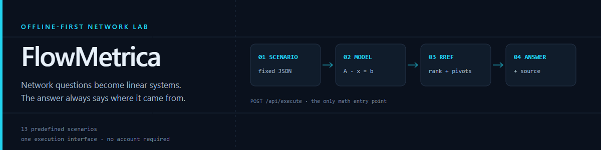
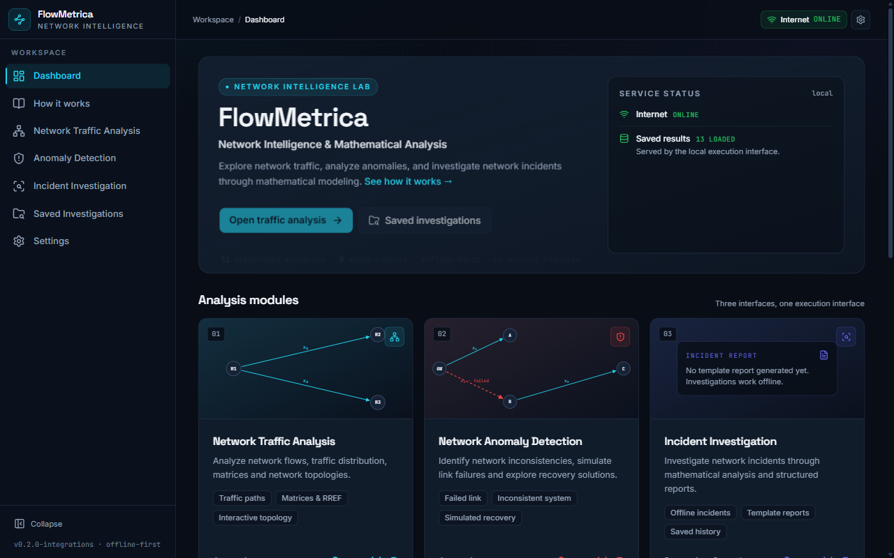
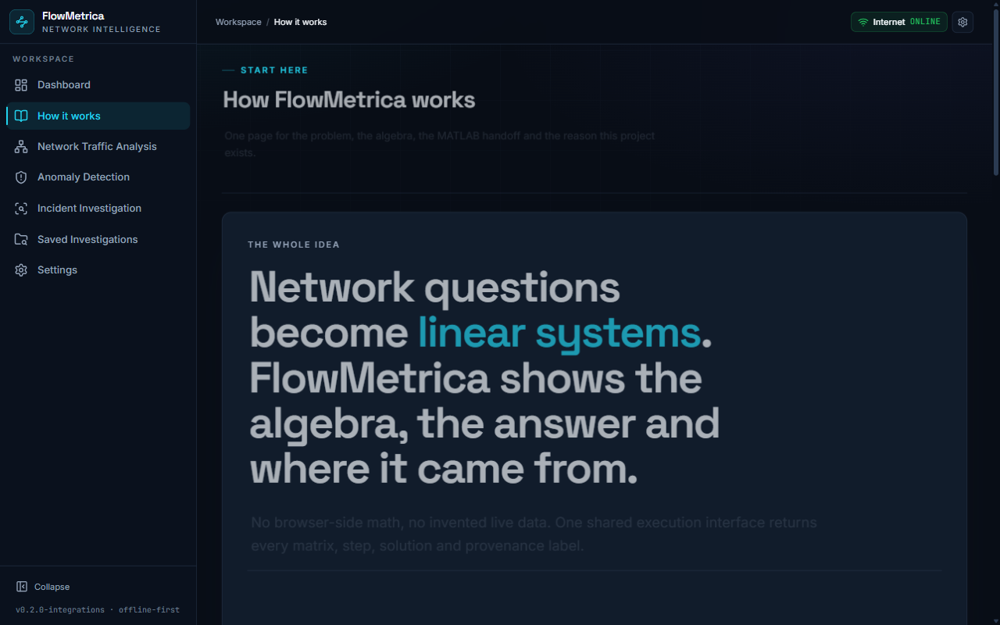
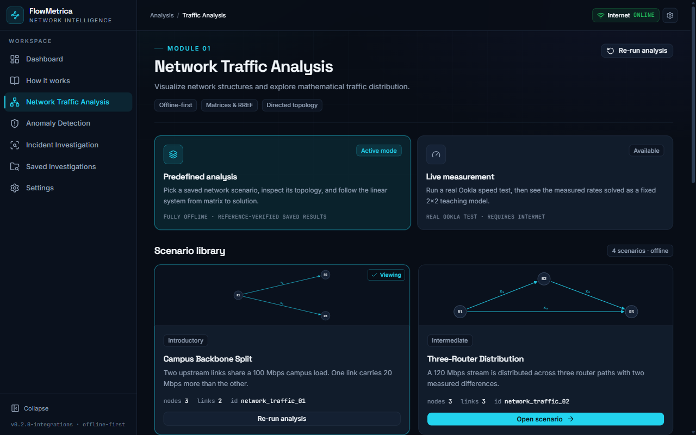
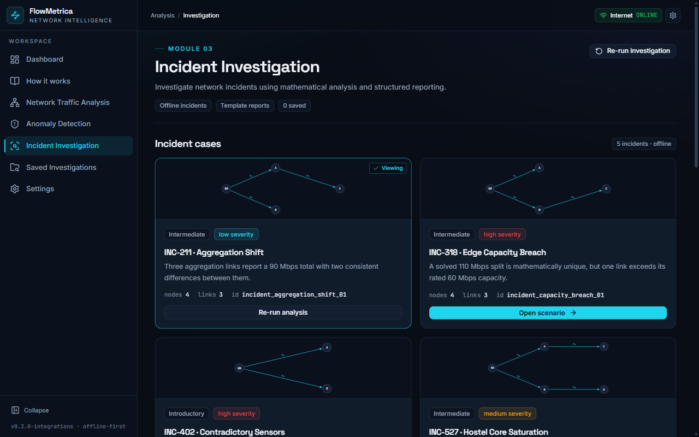
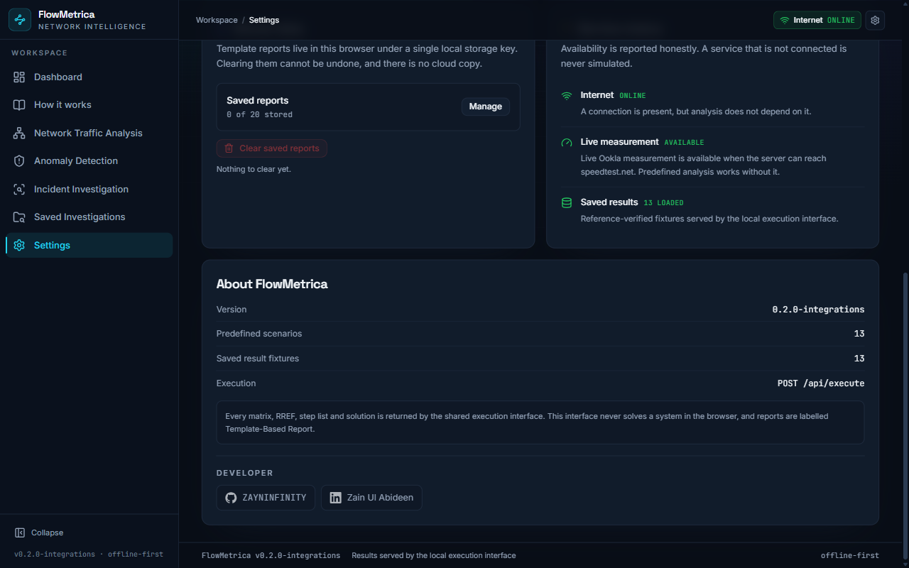
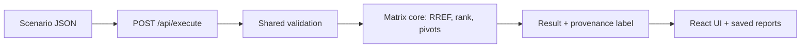

Download banner: [PNG, 1600×400](docs/assets/banner.png) · [SVG source](docs/assets/banner.svg)

# FlowMetrica

**Live demo:** [flowmetrica-maths.vercel.app](https://flowmetrica-maths.vercel.app)

**Offline-first educational network analysis lab.** Three modules turn a fixed network
story into a linear system, show the row reduction behind the answer, and label exactly
where that answer came from. Nothing is computed in the browser and no account is needed.

[How it works](#how-it-works) · [Screenshots](#screenshots) · [Architecture](#architecture) · [Provenance](#result-provenance) · [Run locally](#run-locally) · [Deploy](#deploy) · [Desktop control panel](#desktop-control-panel) · [Pitch deck](docs/PRESENTATION.md) · [Roman Urdu pitch (PDF)](docs/FlowMetrica-Pitch-RomanUrdu.pdf)

---

## Why this exists

Network questions ("how much traffic is on each link?") are conservation equations in
disguise. A small system of linear equations can answer them — and row reduction shows
*why* the answer is unique, impossible, or underdetermined. FlowMetrica makes that chain
visible instead of hiding it behind a number:

**Scenario → A·x = b → RREF → Answer + provenance label**

The honest part matters as much as the algebra. A saved fixture is never presented as a
live MATLAB call, simulated data is never presented as a measurement, and the UI has no
fake "AI" or "connect MATLAB" buttons.

## Screenshots

| Dashboard | How it works |
| :---: | :---: |
|  |  |

| Traffic Analysis | Incident Investigation |
| :---: | :---: |
|  |  |

| Settings — preferences, guarantees and developer links |
| :---: |
|  |

All screenshots are real captures of the running app, not mock-ups.

## The three modules

| Module | Question it answers | Algebra behind it | Offline cases |
|---|---|---|---|
| **1 · Traffic Analysis** | How should a known demand split across parallel links? | Square system → RREF → unique solution vector | 4 scenarios: unique, underdetermined, two mesh splits |
| **2 · Anomaly Detection** | Do the sensor readings satisfy conservation at all? | Inconsistent row → no exact solution → simulated backup-route correction | 4 cases: link failure, redundant sensor, contradictory readings, capacity breach |
| **3 · Incident Investigation** | What does an incident's measurement system actually prove? | Rank + pivots classify the case → structured template report | 5 incidents: unique, infinite, no-solution, capacity breach, hostel core saturation |

Every module reads from the same scenario catalogue and the same saved-result store.
Reports stay in `localStorage`; nothing syncs to a cloud.

## How it works

1. A **scenario** is versioned JSON: coefficient matrix `A`, demand vector `b`, metadata
   and an honest `result_source`.
2. The UI sends it to **`POST /api/execute`** — the single math entry point. The browser
   never solves a system.
3. The server validates input, runs the shared matrix core (Gaussian elimination, RREF,
   rank, pivots), validates the result, and returns steps plus a provenance label.
4. The UI renders matrices, topology, solution and source badge from that one response.



Optional live inputs (Ookla measurement, a configured desktop MATLAB service) enter the
same endpoint on the server. They never change the contract and are never faked when
unavailable.

## Result provenance

`POST /api/execute` always returns `result_source`:

| Value | Meaning |
|---|---|
| `reference_verified_fixture` | Default. Computed by the independent reference implementation and cross-checked against expected values. **Not** a MATLAB result. |
| `matlab_fixture` | Genuine MATLAB export. `INC-318 · Edge Capacity Breach` and `INC-527 · Hostel Core Saturation` were computed in MATLAB Online R2026b and copied back into their fixtures. Still saved results, never live calls. |
| `live_matlab_execution` | A real REST call to a configured desktop MATLAB service. Never claimed without execution. |
| `live_network_measurement` | Real Ookla Mbps fed into the shared math solver on the server. |
| `simulated_data` | Teaching model, not a measurement. |
| `template_generated` | Report assembled locally from verified values. |

MATLAB Online has no supported general-purpose execution API, so the app does not automate
a browser session. MATLAB is used manually to verify exports; the badge says
**Saved MATLAB Result**, never **Live MATLAB Result**.

AI-assisted scenario drafting also happens outside the app: ChatGPT writes staged JSON
(`docs/SCENARIO_PROMPT.md`), MATLAB exports a matching fixture, and only then does the
scenario enter the catalogue. That is why there are no in-app AI, OpenRouter or live-MATLAB
controls.

## Optional live integrations

| Feature | Requirement | Honest behaviour when unavailable |
|---|---|---|
| Ookla speed test | Internet access to speedtest.net | `MEASUREMENT_UNAVAILABLE`; no invented numbers |
| MATLAB live calls | Desktop MATLAB REST Function Service + env vars | Saved results still work; configured failures return an explicit error |
| MATLAB Online verification | Free MathWorks account (20 hr/month) | Manual export of saved fixtures, labelled honestly |

See `matlab/EXPORT_GUIDE.md` for the export workflow and `docs/INTEGRATIONS.md` for the
integration contract. MATLAB bridge variables (never commit them):

```text
MATLAB_REST_URL        https://localhost:9920/matlab/feval/v1/FlowMetrica
MATLAB_REST_TOKEN      <printed by start_rest_service>
MATLAB_REST_CA         <certificate path printed by start_rest_service>
MATLAB_REST_TIMEOUT_MS 15000   (optional)
```

## Architecture

```text
src/                     React UI, hash routing (no router dependency)
                         HowItWorks = canonical product + algebra explainer
                         motion/ = spring stagger, route fade, count-ups
docs/                    UI spec, integration contract, scenario prompt,
                         presentation, Roman Urdu pitch, screenshots
server/routes/           /api/health, /api/scenarios, /api/execute,
                         /api/measure, /api/matlab/setup
server/services/         shared executor, validator, fixtures, matrix core,
                         MATLAB REST bridge, measurement store
server/data/scenarios/   13 versioned scenario definitions (4 / 4 / 5)
server/data/fixtures/    13 versioned result fixtures (JSON)
matlab/                  MATLAB entry points, REST starter, export scripts
scripts/                 reference fixture generator
DESIGN.md                visual brief, type roles, design tokens
```

Input and result validation are shared; a module never implements its own math pipeline.
Measured vectors are built server-side from an opaque measurement id, so a client cannot
attach a `live_network_measurement` label to invented numbers. API responses are served
with `Cache-Control: no-store`.
[Design brief](DESIGN.md) · [UI/UX spec](docs/UI-UX-SPEC.md)

## Run locally

```bash
npm install
npm run dev          # API on :3001, Vite on :5173
npm test             # math + execution interface tests
npm run build        # dist/ served by Express on :3001
npm start            # production-style single origin
```

Open `http://localhost:5173` in dev, or `http://localhost:3001` after a build. All 13
predefined scenarios, saved results and reports work with no internet.

## Deploy

The production build is deployed on Vercel at
[flowmetrica-maths.vercel.app](https://flowmetrica-maths.vercel.app). `vercel.json` routes
`/api/*` to a Node serverless function running the **same Express app** as local mode and
serves `dist/` as static files. The 13 scenario and fixture JSON files are bundled into the
function, so online and offline runs return identical saved results.

Live MATLAB stays OFF on the deployed instance by default. MATLAB Online has no supported
external execution API, and a desktop MATLAB REST service is normally not reachable from a
serverless function. Online mode therefore uses saved results and live Ookla measurement;
local mode can opt into live MATLAB with the desktop control panel.

`npm test` runs **43 tests** covering linear algebra, input purity, row operations,
catalogue integrity, provenance, MATLAB REST decoding, measurement normalisation,
concurrency, expiry, cache headers and live-execution failure paths.

## Desktop control panel

Double-click `FlowMetrica-Control.bat` on Windows for a small WinForms GUI that can
start, stop and restart the local server, open the app, run tests, build, and toggle live
MATLAB. It clears **only** FlowMetrica's own processes on ports 3001/5173. MATLAB REST URL,
token and CA path are kept in the GUI process environment only — masked in the UI, never
written to disk or logs. Use `FlowMetrica-Control.bat -SelfTest` for a headless check.

## Deliberately out of scope

In-app AI/OpenRouter, browser automation of MATLAB Online, authentication, cloud sync,
chart libraries and dead placeholder buttons. Motion is provided by `motion/react`;
reduced-motion users get the same readable content with animation removed.

---

Built by [ZAYNINFINITY](https://github.com/ZAYNINFINITY) ·
[LinkedIn](https://www.linkedin.com/in/zain-ul-abideen-429735231) ·
[Portfolio](https://zainportfoli0.netlify.app)
