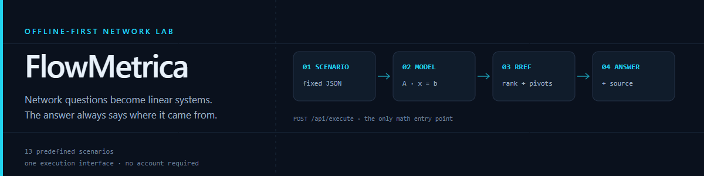
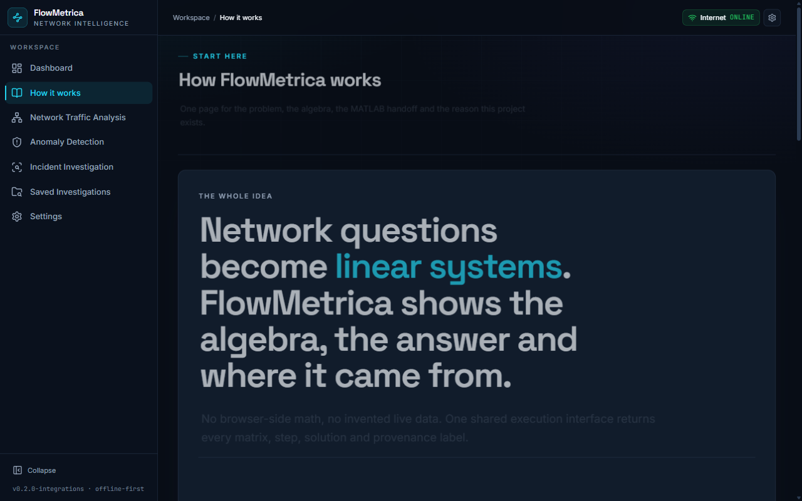
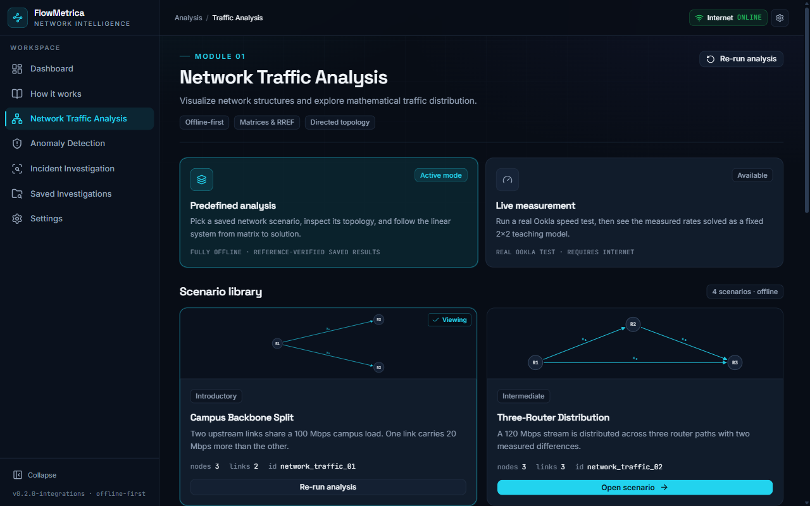
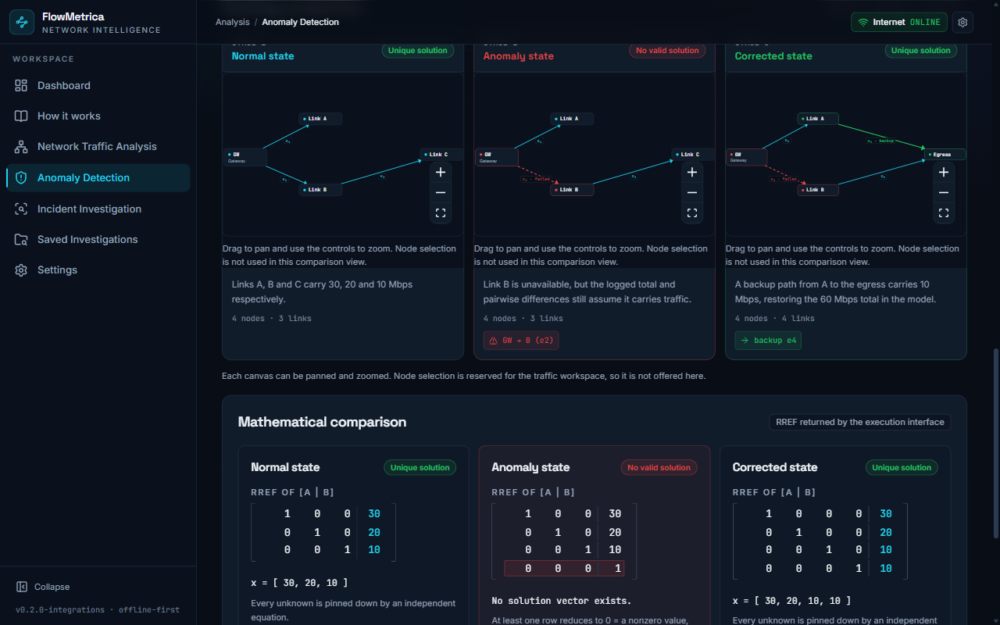
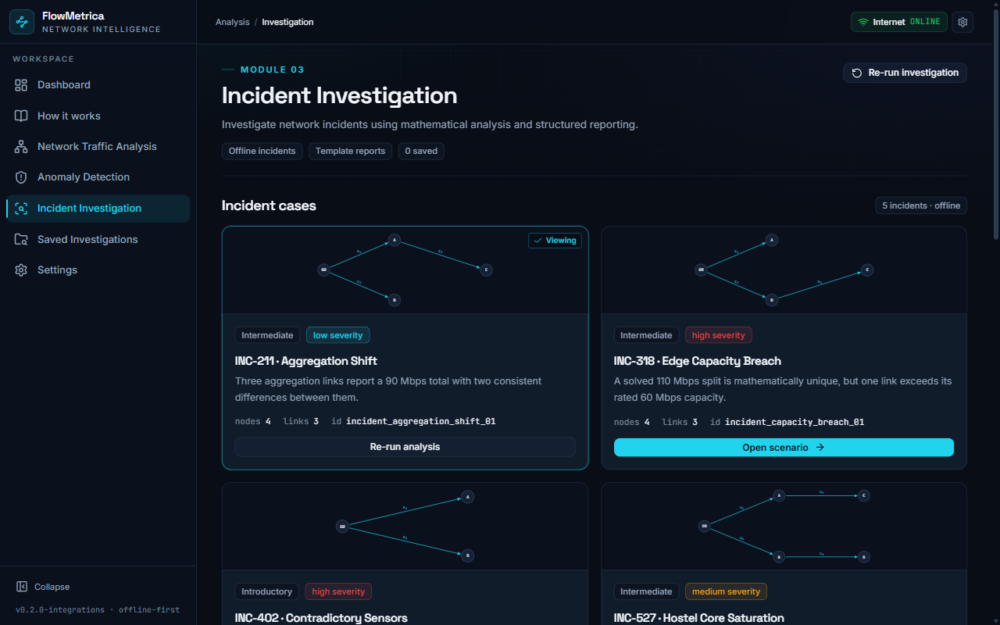

# FlowMetrica — 4-slide presentation

PPT-ready content. **Image paths below are from the repo root**, so a tool like Claude can
read this file and place the images directly. Markdown previews use paths relative to
this `docs/` folder. Use one idea per slide and keep the text on screen short.

## PPT asset manifest

```json
{
  "slides": [
    {
      "number": 1,
      "title": "What is FlowMetrica?",
      "images": [
        "docs/assets/banner.png",
        "docs/screenshots/dashboard.png"
      ],
      "layout": "banner on top, dashboard below, three short bullets"
    },
    {
      "number": 2,
      "title": "How it works",
      "images": [
        "docs/screenshots/how-it-works.png"
      ],
      "layout": "explainer screenshot on the right, four-step flow on the left"
    },
    {
      "number": 3,
      "title": "Three modules",
      "images": [
        "docs/screenshots/traffic-analysis.png",
        "docs/screenshots/anomaly-detection.png",
        "docs/screenshots/investigation.png"
      ],
      "layout": "three equal cards, one screenshot per module"
    },
    {
      "number": 4,
      "title": "Why linear algebra, and why MATLAB?",
      "images": [
        "docs/screenshots/traffic-analysis.png"
      ],
      "layout": "matrix screenshot on the left, three plain-language points on the right"
    }
  ]
}
```

---

## Slide 1 — What is FlowMetrica?

**Images (repo-root paths)**

- `docs/assets/banner.png`
- `docs/screenshots/dashboard.png`

**Previews**




**On screen**

> A small offline lab that turns a network story into an equation,
> solves it, and shows where the answer came from.

- Works with no internet, no login, no setup
- 13 ready-made network stories
- Built to show the math, not hide it

**Speaker note:** "Sir, network traffic looks messy, but junction rules turn it into a few equations. FlowMetrica makes that visible."

---

## Slide 2 — How it works

**Image (repo-root path)**

- `docs/screenshots/how-it-works.png`

**Preview**



**On screen**

> **Story → Equation → Reduce → Answer + Source**

1. Pick a scenario — fixed JSON, no typing
2. Server builds `A·x = b`
3. Row reduction gives rank, pivots and solution
4. Answer returns with an honest provenance label

One shared entry point: `POST /api/execute`. The browser never does the math.

**Speaker note:** "Everything goes through one door. That is why the three modules cannot disagree with each other."

---

## Slide 3 — Three modules

**Images (repo-root paths)**

- `docs/screenshots/traffic-analysis.png`
- `docs/screenshots/anomaly-detection.png`
- `docs/screenshots/investigation.png`

**Previews**







**On screen**

| Module | Question | What you see |
|---|---|---|
| **1 · Traffic Analysis** | How should demand split across links? | Flow vector, matrix steps, topology |
| **2 · Anomaly Detection** | Do the readings add up? | Inconsistency, simulated backup route |
| **3 · Investigation** | What does an incident really prove? | Rank/pivots, structured report |

**Speaker note:** "Same question at three depths: plan a healthy network, catch a broken one, then write up an incident."

---

## Slide 4 — Why linear algebra, and why MATLAB?

**Image (repo-root path)**

- `docs/screenshots/traffic-analysis.png`

**Preview**


**On screen**

> Network flow is conservation. Conservation is a system of equations.

- Rows = junctions; unknowns = link flows
- Rank and pivots say: unique, impossible, or many answers
- MATLAB verifies exports independently — not a live cloud runner
- Saved result means saved result. Never called "live" unless it really ran live

**Speaker note:** "MATLAB is an independent checker here, not a magic API. The honesty of the label is part of the project."

---

### Demo order (optional)

1. `#/overview` — show the one-line flow
2. `#/module1` — open a scenario, show matrix → RREF → solution
3. `#/module2` — show an inconsistent case
4. `#/module3` — show one incident report
5. `#/settings` — show preferences, guarantees and developer links

Full spoken pitch: [FlowMetrica-Pitch-RomanUrdu.pdf](FlowMetrica-Pitch-RomanUrdu.pdf)
